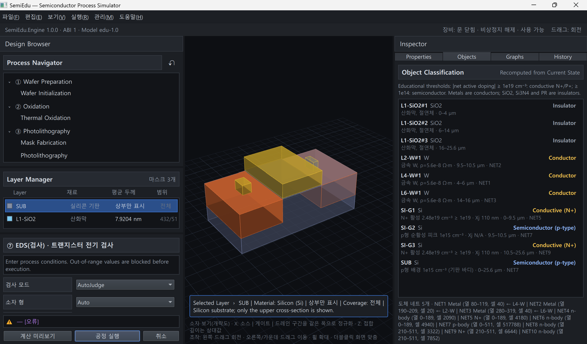

# SemiSim

### 공정 조건을 넣으면 웨이퍼가 바뀌고, 그 웨이퍼가 트랜지스터로 동작하는지까지 판정하는 3D 반도체 공정 시뮬레이터



<sub>학습 경로 5(마스크 제작 → 초기화 → 게이트 산화 → W 게이트 → As 자기정렬 주입 → RTA → 컨택 → 전기 검사)를 끝까지 실행한 화면입니다. 가운데는 엔진이 계산한 웨이퍼 상태로 그린 NMOS 소자 보기입니다. 오른쪽 Inspector는 같은 상태를 Union-Find로 분석해 얻은 도체 네트와 영역별 전기적 분류(N+ / p형 / 금속 / 절연체)를 보여 줍니다.</sub>

---

## 한눈에 보기

| | |
| --- | --- |
| **무엇을** | 산화 · 포토 · 식각 · 증착 · 이온주입 · 열처리 · CMP · 배선 · 컨택 등 **14개 공정 모델**과 트랜지스터 전기 검사 |
| **어떻게** | 조건 입력 → 4단계 사전 차단 → 계산 → 품질 판정 → 커밋. 장비 소프트웨어의 레시피 실행 흐름을 그대로 따릅니다. |
| **결과** | 3D 단면, 도핑 분포, 도체 네트 분석, Id–Vg / Id–Vd 곡선, Ion · Ioff · Vth 판정 |
| **기술** | Qt 6 QML(MVVM) · C++17 · OpenGL 3.3 인스턴싱 · C# .NET 8 NativeAOT · C ABI · xUnit |
| **검증** | 엔진 xUnit 63개 + 배포 DLL 자가 테스트 42개 + OpenGL 렌더링 테스트 + ViewModel 테스트 |

---

## 장비 소프트웨어처럼 설계했습니다

공정 장비는 결과를 잘 계산하는 것만큼, **돌리면 안 되는 레시피를 돌리지 않는 것**이 중요합니다. SemiSim은 모든 공정을 같은 실행 파이프라인([Pipeline.cs](SemiEduQt/engine/SemiEdu.Engine/Engine/Pipeline.cs))에 통과시킵니다.

```text
원문 입력
   │
   ▼
① 입력 검증 ──▶ ② 웨이퍼 선행조건 ──▶ ③ 장비 인터록 ──▶ ④ 모델 적용 범위
                                                              │
                                                              ▼
       커밋 ◀── 품질 판정 ◀── 결과 불변조건 검사 ◀── 후보 상태 계산
```

- **인터록:** 장비 문 열림, 비상정지, 공정별 장비 한계 19종이 있습니다. 예를 들어 주입 에너지는 200 keV, 어닐 온도는 1100 °C를 넘으면 계산 전에 막습니다.
- **선행조건:** 웨이퍼 상태로 판단하는 39종이 있습니다. PR이 남은 상태의 열처리, 게이트 금속이 아닌 금속이 있는 상태의 고온 공정, 너무 두꺼운 스크린 산화막 등이 해당합니다.
- **실패 원인 분리:** 어느 단계에서 막혔는지에 따라 결과를 `InvalidInput` / `PreconditionFailed` / `Interlock` / `ModelOutOfDomain` / `ProcessFailure`로 나눕니다. 차단된 단계 이후는 `NotRun`으로 남겨서 작업자가 원인을 바로 알 수 있습니다.
- **상태 충돌 방지:** 실행 요청은 기대 Revision을 함께 보냅니다. 그사이 웨이퍼 상태가 바뀌었으면 `STALE_STATE`로 커밋을 거부합니다. 오래된 화면을 보고 내린 명령이 실제 상태를 덮어쓰지 않습니다.
- **불량 이후 진행 통제:** 직전 공정이 품질 불량이면 다음 공정을 엔진이 막습니다. 계속하려면 ‘불량 상태로 계속 학습’을 명시적으로 켜야 합니다.
- **미리보기와 커밋 분리:** 계산 결과와 3D 화면을 먼저 확인하고, 웨이퍼에 반영하는 건 그다음입니다.
- **되돌리기:** 공정을 골라 그 지점까지 되돌릴 수 있습니다. 뒤에 진행한 공정까지 함께 사라지면 한 번 확인을 받습니다. 실행 이력은 지우지 않고, History에서 각 공정에 입력한 값을 다시 볼 수 있습니다.
- **비동기 실행과 취소:** 계산은 `QtConcurrent` 워커에서 돌기 때문에 UI가 멈추지 않습니다. 취소 요청은 별도 경로로 엔진에 전달합니다.

---

## 공정에서 소자까지 이어집니다

공정 결과를 그림으로 보여 주는 데서 끝내지 않습니다. 직접 만든 구조가 **트랜지스터로 동작하는지** 엔진이 판정합니다.

```text
단면 · 활성 도핑 농도
   → 영역별 전기적 분류 (N+ / P+ / n형 / p형 / 금속 / 절연체)
   → Union-Find 연결 분석으로 도체 네트 구성
   → Gate / Source / Drain 단자와 채널 구조 확인
   → 단락 · 개방 · 접합 없음 · 게이트 누설 검사
   → 장채널 MOSFET 모델로 Ion · Ioff · on/off 비 · Vth 계산
```

- **[Netlist.cs](SemiEduQt/engine/SemiEdu.Engine/Electrical/Netlist.cs):** 금속과 도핑 영역의 연결 관계를 분석합니다.
- **[Transistor.cs](SemiEduQt/engine/SemiEdu.Engine/Electrical/Transistor.cs):** 구조 결함과 전기 특성을 판정합니다.

마스크 정렬이 어긋나거나 주입 조건이 잘못되면 그 결과가 `OPEN_SOURCE`, `SD_SHORT`, `NO_JUNCTION` 같은 구조 판정과 전류값으로 바로 나타납니다.

---

## 아키텍처

```text
┌──────────────────────────────────────────────────────────┐
│ View · QML              공정 목록 / 입력 폼 / 결과 / 이력  │
└──────────────────────────────────────────────────────────┘
        │ 명령                          ▲ 속성 바인딩
        ▼                               │
┌──────────────────────────────────────────────────────────┐
│ ViewModel · C++ QObject  실행 · Undo · 동적 폼 · 씬 상태   │
└──────────────────────────────────────────────────────────┘
        │ QtConcurrent 워커
        ▼
┌──────────────────────────────────────────────────────────┐
│ EngineClient · C++       DLL 로드 · ABI 버전 검사 · JSON   │
└──────────────────────────────────────────────────────────┘
        │ C ABI (se_form / se_run / se_state / se_scene_*)
        ▼
┌──────────────────────────────────────────────────────────┐
│ Engine · C# NativeAOT    검증 → 파이프라인 → 공정 모델     │
│                          → 품질 판정 → Session            │
│                          Netlist · MOSFET · SceneBuilder  │
└──────────────────────────────────────────────────────────┘
        │ 씬 박스 배열
        ▼
  C++ BoxRenderer (OpenGL 3.3)  ·  PlotItem (전류 곡선)
```

- **화면과 계산의 분리:** QML에는 검증이나 계산 코드가 없습니다. 공정 수식, 검증, 판정은 모두 C# 엔진이 맡습니다. 그래서 UI를 바꿔도 공정 로직은 그대로입니다.
- **언어 경계는 C ABI 하나:** C++ 앱과 C# 엔진은 버전이 매겨진 C ABI와 UTF-8 JSON으로만 통신합니다. 엔진은 NativeAOT로 네이티브 DLL이 되므로 .NET 런타임 없이 로드됩니다. 앱과 엔진이 서로 다른 컴파일러(MinGW / MSVC)로 빌드돼도 연결됩니다.
- **엔진이 결정하는 입력 폼:** 표시할 필드, 선택지, 범위, 오류 메시지를 엔진이 정합니다. 숫자도 원문 문자열 그대로 전달해서, UI가 잘못된 입력을 임의로 고치지 않습니다.
- **타입이 있는 레시피:** 검증을 통과한 입력은 공정별 불변 레코드로 바뀐 뒤 계산에 들어갑니다. 빠진 필수값이 0으로 바뀌어 계산되는 일이 없습니다.

### 렌더링 성능

[BoxRenderer.cpp](SemiEduQt/app/render/BoxRenderer.cpp)의 방식은 다음과 같습니다.
- 모든 박스가 단위 큐브 메시 하나를 공유하고, 위치·크기·색상만 인스턴스 데이터로 보냅니다.
- 프러스텀 컬링으로 화면 밖 박스를 제외합니다.
- 장면이 바뀌지 않으면 GPU 업로드를 생략합니다.

| 항목 | 결과 |
| --- | --- |
| draw call | 박스 수와 관계없이 최대 4회 (격자 · 불투명 · 외곽선 · 반투명) |
| 박스당 동적 업로드 | 기존 정점 전개 방식 2,400 B → 80 B |
| 부하 검증 | 1천 · 1만 · 5만 박스에서 버퍼 재사용과 반투명 정렬을 OpenGL 테스트로 확인 |

---

## 검증

| 대상 | 방법 | 현재 결과 |
| --- | --- | --- |
| 공정 · 판정 엔진 | xUnit: 시나리오, 입력 타입, ABI 계약, 부분 Undo | 63개 중 58개 통과 |
| 배포된 NativeAOT DLL | `SemiEduApp.exe --selftest`: 실제 DLL로 시나리오 42개 실행 | 42개 중 38개 통과 |
| 렌더러 | 오프스크린 OpenGL: 컬링, 업로드량, 반투명 정렬, 5만 박스 | 통과 |
| ViewModel | 부분 Undo, 확인 경고, 레이어 설명, 선택 해제 | 통과 |

> **실패 5건은 의도적으로 남긴 기록입니다.** 금속은 직접 맞닿은 N+/P+ 표면 셀에만 연결된다는 명세 9장 원문 규칙을 우선 적용했습니다. 그러자 기본 NMOS 경로의 정상 동작 기대값과 충돌했습니다. 테스트 기대값을 바꿔 통과시키지 않고, 충돌 원인과 테스트별 결과를 [SemiEduQt/README.md](SemiEduQt/README.md#원문-우선-검증-2026-11-17)에 그대로 기록했습니다.

---

## 학습 경로

[scripts](SemiEduQt/scripts)의 JSON을 `--script`로 넘기면 처음부터 끝까지 그대로 재생됩니다.

| 경로 | 흐름 | 확인할 결과 |
| --- | --- | --- |
| 1. 패턴 형성 | 초기화 → 산화 → 마스크 · 포토 → 식각 → PR 제거 → 검사 | 개구부 식각과 PR 제거 |
| 2. 도핑 | 초기화 → 이온주입 → RTA → 검사 | 농도 프로파일과 활성화율 |
| 3. 배선 | 산화막 → 세정 → Al 배선 → 검사 | 배선 저항 |
| 4. 평탄화 | 산화막 → CVD → CMP → 검사 | 잔여 막 두께 |
| 5. NMOS | 마스크 → 초기화 → 게이트 산화 · 전극 → 주입 → RTA → 컨택 → 전기 검사 | 구조 판정과 on/off 동작 |

---

## 빌드와 실행 (Windows)

**필요한 것:**
- Qt 6.11.1 (MinGW 64-bit)
- .NET SDK (엔진 대상 `net8.0`)
- Visual Studio C++ 빌드 도구 (NativeAOT 링커)

```powershell
cd SemiEduQt
./build.ps1                                                # 엔진 → xUnit → 앱 빌드 → 배포 → 자가 테스트
build/SemiEduApp.exe --script scripts/path5-nmos.json      # NMOS 경로를 재생한 상태로 시작
```

수동 빌드 절차, 확인한 환경, 명세와 다르게 구현한 부분은 [SemiEduQt/README.md](SemiEduQt/README.md)에 정리했습니다.

---

## 디렉터리

```text
SemiSim/
├─ SemiEduQt/                 현재 앱
│  ├─ app/                    C++ · QML: ViewModel, EngineClient, OpenGL 렌더러
│  ├─ engine/SemiEdu.Engine/  C# 엔진: Domain · Engine · Processes · Electrical · Scene
│  ├─ engine.tests/           xUnit
│  └─ scripts/                학습 경로 1–5
├─ images/                    README 이미지
├─ src/SemiconductorEdu.*/    이전 WPF 구현
└─ docs/                      명세 검토 기록
```

> 모든 계수, 장비 한계, 품질 기준은 교육용 예시 값입니다. 식의 형태는 Deal–Grove, Gaussian 주입 분포, square-law MOSFET 같은 문헌 모델을 따랐지만, 계수는 이 프로젝트가 정한 값입니다. 실제 레시피, 장비 운전 한계, 수율을 예측하는 데 쓸 수 없습니다.
